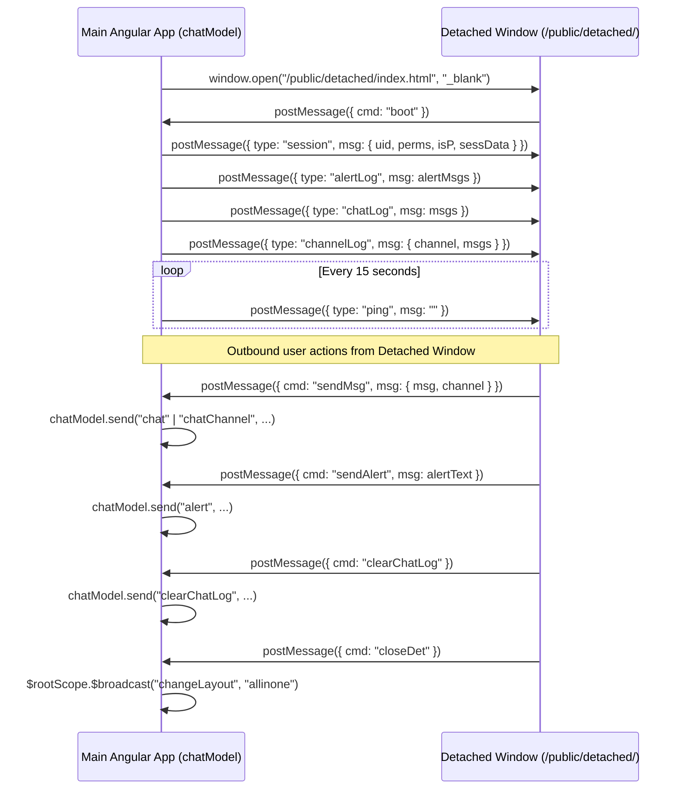

# Forensic Research Report 3: Controllers, `chatModel` SockJS Wire Protocol & REST `/users/v1/*` API Specification

## 1. Executive Summary & Architecture Overview

The ProTradingRoom (PTR) frontend web application is built on AngularJS (v1.x) with integrated WebRTC (Janus Gateway), SockJS real-time communication, and a RESTful backend API hosted under `/users/v1/*` and `/ptr_app/mp/v2/*`.

### Key Components Inspected:
- **`18_service_LayerMorph.js`**: Houses `LayerMorph` animation service, `HeaderNavController`, and `InviteModalCtrl`.
- **`23_controller_ChatCtrl.js`** (220 KB, 3,208 lines): Core monolithic controller housing `ChatCtrl`, `ModalInstanceCtrl`, `ModalSessionCtrl`, `AlertsModalInstanceCtrl`, and the extensive `LoginCtrl` (account management, badges, API keys, admin users, session configuration, marketplace integration, and authentication).
- **`24_filter_function.js`**: Houses `SideBarCtrl` (roster management, user search, OBS/YouTube/Facebook streaming controls, layout controls, user moderation).
- **`25_controller_UserInfoCtrl.js`**: User moderation modal (`UserInfoCtrl`) covering permissions, temporary presenter assignment, remote kick/ban/mute, audio/screen reload, and private chat initiation.
- **`26_controller_KickedCtrl.js`**: Displays disconnection/kick reasons.
- **`27_controller_DisclosureCtrl.js`**: Financial disclaimer and initials agreement modal before joining room.
- **`28_controller_PollCtrl.js`**: Poll management, live Flot pie charts, response tallying, and export.
- **`29_controller_UsersCtrl.js`**: Auxiliary roster view controller.
- **`30_controller_FilesCtrl.js`**: Room drive, sound files, background images, logos, and file uploads.
- **`36_filter_function.js`** (73 KB, 771 lines): The central real-time communication engine (`chatModel` service) managing SockJS sockets, Janus media state, WebRTC renegotiations, detached chat window synchronization, and user rosters.

---

## 2. Complete REST HTTP Endpoint Specification

All requests made via `$http.post`, `$http.get`, `Upload.upload`, `$.ajax`, and `XMLHttpRequest` are cataloged below with exact paths, HTTP methods, headers, request bodies, expected responses, and controller actions.

```
Base API URL: appVars.globals.APIURL (e.g., https://api.protradingroom.com or window.location.origin)
```

### 2.1. Authentication & Account Endpoints

#### `POST /users/v1/login`
- **Controller**: `LoginCtrl` (`$scope.submitLogin`)
- **Headers**: `Content-Type: application/json`
- **Request Body**:
  ```json
  {
    "email": "user@example.com",
    "pw": "user_password",
    "recaptcha": "g-recaptcha-response-string",
    "source": "webApp"
  }
  ```
- **Response**:
  ```json
  {
    "success": true,
    "name": "User Nickname",
    "token": "JWT_SITE_TOKEN",
    "failedLoginCount": 0,
    "message": "Error message if failed"
  }
  ```
- **Handler**:
  - Sets `chatModel.jwtTokenSite = data.token`, stores in `$localstorage.put("tokenSite", data.token)`.
  - Sets `chatModel.nick = data.name`, `chatModel.email = $scope.signup.email`.
  - Resets `failedLoginCount`, invokes `$scope.getSessions()`, navigates `$state.go("page.welcome")`.
  - On failure: increments and saves `failedLoginCount`, alerts `data.message`.

#### `POST /users/v1/login_tok`
- **Controller**: `LoginCtrl` (`$scope.loginWithToken`)
- **Request Body**:
  ```json
  {
    "token": "JWT_SITE_TOKEN",
    "email": "user@example.com",
    "source": "webApp"
  }
  ```
- **Response**:
  ```json
  {
    "success": true,
    "name": "User Nickname",
    "closedTxt": "HTML or string session closed message"
  }
  ```
- **Handler**:
  - Re-authenticates returning site admin/user from stored site token.
  - Updates `chatModel.closedMsg` (wraps plain text in `<h2>...</h2>` if no HTML tag).
  - Invokes `$scope.getSessions()` and transitions to target state. On error calls `$scope.doLogout()`.

#### `POST /users/v1/signup`
- **Controller**: `LoginCtrl` (`$scope.submitSignup`)
- **Request Body**:
  ```json
  {
    "name": "Full Name",
    "email": "user@example.com",
    "pw": "password",
    "recaptcha": "g-recaptcha-response-string",
    "source": "webApp",
    "demo": true
  }
  ```
- **Response**: `{ "success": true, "token": "JWT_TOKEN", "demo": true, "message": "..." }`
- **Handler**: Stores token in `tokenSite`, transitions to `page.welcome`, calls `$scope.createNew()`.

#### `POST /users/v1/demoSignup`
- **Controller**: `LoginCtrl` (`$scope.submitDemoSignup`)
- **Request Body**:
  ```json
  {
    "name": "Full Name",
    "email": "user@example.com",
    "pw": "password",
    "roomName": "Demo Trading Room",
    "clusterID": "cluster_id_str",
    "recaptcha": "g-recaptcha-response-string",
    "source": "webApp",
    "demo": true
  }
  ```
- **Response**: `{ "success": true, "token": "JWT_TOKEN", "roomID": "...", "roomUUID": "...", "demo": true, "message": "..." }`
- **Handler**: Stores `tokenSite`, navigates to `page.manageSession` with `sessionID: data.roomID`.

#### `POST /users/v1/change-password`
- **Controller**: `LoginCtrl` (`$scope.submitChangePassword`)
- **Request Body**:
  ```json
  {
    "userUUID": "uuid_from_url_hash",
    "passNew": "new_password",
    "recaptcha": "g-recaptcha-response",
    "source": "webApp"
  }
  ```
- **Response**: `{ "success": true, "message": "Password changed successfully" }`

#### `POST /users/v1/user-change-password`
- **Controller**: `LoginCtrl` (`$scope.submitUserChangePassword`)
- **Request Body**:
  ```json
  {
    "userUUID": "uuid_from_url_hash",
    "passNew": "new_password",
    "recaptcha": "g-recaptcha-response",
    "source": "webApp"
  }
  ```
- **Response**: Status object stored in `$scope.userChangePasswordStatus`.

#### `POST /users/v1/forgot-password` & `POST /users/v1/user-forgot-password`
- **Controller**: `LoginCtrl` (`$scope.submitForgotPassword`, `$scope.submitUserForgotPassword`)
- **Request Body**:
  ```json
  {
    "email": "user@example.com",
    "recaptcha": "g-recaptcha-response",
    "source": "webApp"
  }
  ```
- **Response**: Status object stored in `$scope.forgotPasswordStatus` / `$scope.userForgotPasswordStatus`.

---

### 2.2. Room Authentication & Multiplexed `users.json` Endpoints

All calls to `/users/v1/users.json` send a JSON body with a distinguishing `cmd` attribute:

#### `POST /users/v1/users.json` — `cmd: "loginChat"`
- **Controller**: `LoginCtrl` (`$scope.login`)
- **Request Body**:
  ```json
  {
    "cmd": "loginChat",
    "roomID": "room_uuid_or_id",
    "email": "user@example.com",
    "pw": "room_password",
    "tagline": "User tagline",
    "pin": "1234",
    "siteToken": "JWT_SITE_TOKEN_OR_NULL",
    "token": "JWT_ROOM_TOKEN_OR_NULL"
  }
  ```
- **Response**:
  ```json
  {
    "uuid": "session_uuid",
    "_id": "session_mongo_id",
    "name": "Room Name",
    "authMode": "open|unamePW|jwt|webinarRoom|registrationA",
    "alertsOnBottom": false,
    "media_server": "m1.protradingroom.com",
    "media_relays": "m1.protradingroom.com|443,m2.protradingroom.com|443",
    "message": "Error reason if login failed"
  }
  ```
- **Handler**:
  - Initializes local storage credentials (`phone`, `email`, `nick`, `tagline`).
  - Calls `$scope.setSessionVarsFromData(data)`.
  - Determines dashboard state: `appVars.sessData.alertsOnBottom ? "app.dashboard-alt" : "app.dashboard"`.
  - Connects SockJS via `chatModel.connect(appVars.globals.chatServerURL)`.

#### `POST /users/v1/users.json` — `cmd: "registerByEmail"`
- **Controller**: `LoginCtrl` (`$scope.submitRegistration`)
- **Request Body**:
  ```json
  {
    "cmd": "registerByEmail",
    "roomID": "room_uuid",
    "name": "Participant Name",
    "email": "participant@example.com",
    "recaptcha": "g-recaptcha-response"
  }
  ```
- **Response**: `{ "success": true, "message": "Registration confirmation message" }`
- **Handler**: Sets `$scope.regDone = true`, stores email and nickname, alerts message.

#### `POST /users/v1/users.json` — `cmd: "newSession"`
- **Controller**: `LoginCtrl` (`$scope.createNew`)
- **Request Body**:
  ```json
  {
    "cmd": "newSession",
    "email": "owner@example.com",
    "token": "JWT_SITE_TOKEN",
    "demoRoom": true
  }
  ```
- **Response**: `{ "_id": "session_id", "uuid": "session_uuid" }`
- **Handler**: Navigates to `page.manageSession` with `sessionID: data._id`.

#### `POST /users/v1/users.json` — `cmd: "logout"`
- **Controller**: `LoginCtrl` (`$scope.doLogout`)
- **Request Body**:
  ```json
  {
    "cmd": "logout",
    "email": "user@example.com",
    "token": "JWT_SITE_TOKEN"
  }
  ```
- **Response**: Clears local site token, resets `chatModel.login.isLoggedIn = false`, transitions to `page.welcome`.

#### `POST /users/v1/users.json` — `cmd: "getAttachments"`
- **Controller**: `ChatCtrl` (`$scope.getFiles`)
- **Request Body**:
  ```json
  {
    "cmd": "getAttachments",
    "roomID": "room_uuid"
  }
  ```
- **Response**: Array of attachment objects `[{ "name": "...", "url": "...", "uploadTime": "...", "size": 12345 }]`.
- **Handler**: Updates `$scope.fileList = data`, configures file serving URL to `/users/v1/serveFile`.

#### `POST /users/v1/users.json` — `cmd: "inviteParticipants"`
- **Controller**: `InviteModalCtrl` in `18_service_LayerMorph.js`
- **Request Body**:
  ```json
  {
    "cmd": "inviteParticipants",
    "roomID": "room_uuid",
    "participants": "[{\"name\":\"John\",\"email\":\"john@example.com\"}]"
  }
  ```
- **Response**: `{ "success": true, "msg": "..." }`
- **Handler**: Alerts "Invite Sent..." on success.

---

### 2.3. The Master Multiplexed Session Endpoint: `POST /users/v1/sessions`

The vast majority of backend room operations use `POST /users/v1/sessions`. Requests construct a base payload via `makeReqTokenForCmd(cmd)`:
```javascript
{
  token: $localstorage.get("tokenSite") || chatModel.jwtToken,
  tokenSite: $localstorage.get("tokenSite"),
  cmd: "<command_name>",
  source: "webApp",
  sessionID: "<session_id>"
}
```

#### Detailed Command Catalog for `POST /users/v1/sessions`:

| Command (`cmd`) | Controller & Invoking Function | Additional Request Payload Fields | Expected Response Shape | Controller State Mutation / Handling |
|---|---|---|---|---|
| `list` | `LoginCtrl.getSessions` | None (base fields only) | `[ sessionObject, ... ]` | Sorts sessions, populates `$scope.login.sessions`, triggers `listApiKeys()` and `listAdminUsers()` |
| `sessionDetails` | `LoginCtrl.getSessionDetails(..., false)` | `sessionID: sessId` | `{ session: { ... }, xrefs: [ ... ] }` | Sets `$scope.sess = data.session`, sets `$scope.badges.hasBadges` |
| `sessionDetailsShort` | `LoginCtrl.getSessionDetails(..., true)` | `uuid: $scope.roomID` | `{ session: { ... } }` | Sets `$scope.sess = data` |
| `sessionPubData` | `LoginCtrl.getPubSessionDetails` | `sessionID: sessId` | `{ name, authMode, logoURL, customEnterDisclosure, strictBrowserMode, hidePoweredBy, ... }` | Sets `appVars.pubSessionData`, broadcasts `"sessionPubDataLoaded"`, updates document title and favicon |
| `saveSessField` | `LoginCtrl.saveSessField` | `fieldName: string`, `fieldVal: any` | `{ success: boolean }` | Updates room configuration in database |
| `cloneSession` | `LoginCtrl.cloneSession` | `name: string` (new room name) | `{ success: boolean, sessionID: string }` | Alerts success, refreshes session list |
| `deleteSession` | `LoginCtrl.deleteSession` | `sessionID: sessId` | `{ success: boolean }` | Alerts success, reloads sessions |
| `changeCustomURL` | `LoginCtrl.setCustomRoomURL` | `cname: string` (alphanumeric alias) | `{ success: boolean, msg: string }` | Updates `$scope.sess.customCname = cname` |
| `uniqueLinkLogin` | `LoginCtrl.setUniqueRoomURL` | None | `{ success: boolean, uniqueLinkLogin: string }` | Updates `$scope.sess.uniqueLinkLogin` |
| `updateClusterID` | `LoginCtrl.updateClusterID` | None | `{ success: boolean }` | Refreshes session details |
| `resetMaxCounts` | `LoginCtrl.resetMaxCount` | None | `{ success: boolean }` | Sets `$scope.sess.recordedMaxCapacity = 0`, `$scope.sess.current_max = 0` |
| `userList` | `LoginCtrl.loadUsers` / `loadMobileUsers` | `searchTerm: string` | `{ xrefs: [ userObject, ... ] }` | Populates `$scope.completeUserList` and `$scope.xrefs` |
| `userListBanned` | `LoginCtrl.loadBannedUsers` | `searchTerm: ""` | `{ xrefs: [ userObject, ... ] }` | Populates `$scope.xrefs` with banned users |
| `userListPresenters` | `LoginCtrl.loadPresentersUsers` | `searchTerm: ""` | `{ xrefs: [ userObject, ... ] }` | Populates `$scope.xrefs` with presenters |
| `userListMuted` | `LoginCtrl.loadMutedUsers` | `searchTerm: ""` | `{ xrefs: [ userObject, ... ] }` | Populates `$scope.xrefs` with muted users |
| `userListMarketplace` | `LoginCtrl.loadMarketplaceUsers` | `searchTerm: ""` | `{ xrefs: [ userObject, ... ] }` | Populates `$scope.xrefs` with marketplace users |
| `showFreeTrials` | `LoginCtrl.loadUsersFT` | None | `{ xrefs: [ userObject, ... ] }` | Populates `$scope.xrefs` with free trial users |
| `clearUserList` | `LoginCtrl.clearUserList` | None | `{ xrefs: [ userObject, ... ] }` | Deletes non-presenters; marks inactive (>7 days) users |
| `clearUserListFT` | `LoginCtrl.removeUsersFT` | None | `{ xrefs: [ userObject, ... ] }` | Deletes all free trial users |
| `clearTokensForUsers` | `LoginCtrl.removeBadgesForUsers` | None | `{ success: boolean }` | Removes all badges from all users; reloads user list |
| `updateUserXref` | `LoginCtrl.updateUser` / `saveUserPermissions` | `xrefID: string`, optionally `newRole: int`, `newPW: string`, `emailOut: bool`, `newBadges: array`, `allRooms: bool`, `isPMUpdate: bool`, `restrictPM: bool`, `permsChange: bool`, `hasMic: bool`, `hasScreen: bool`, `hasCam: bool`, `hasAdminChat: bool`, `canEditNotes: bool`, `note: string` | `{ success: boolean }` | Updates single user permissions, badges, roles, or notes |
| `updateUserXrefMulty` | `LoginCtrl.updateManyUsers` | `newRole: int`, `applyToAllRooms: bool`, `xrefIDs: string[]` OR `emailList: string[]` | `{ success: boolean }` | Batch updates roles across checked users |
| `updateUserXrefMultyEmailList` | `LoginCtrl.actionsWithEmailList` | `emailList: string[]`, `applyToAllRooms: bool`, `newRole: int` (1=Pres, 2=Participant, 3=Mute, 4=Ban, 5=Admin non-pres, 6=Trial, 10=Remove) | `{ success: boolean }` | Batch applies roles from textarea list |
| `updateUserXrefMultyBadge` | `LoginCtrl.updateManyUsersBadge` | `badge: string` (badgeID), `badgeCmd: "add"|"remove"`, `applyToAllRooms: bool`, `xrefIDs: []` or `emailList: []` | `{ success: boolean }` | Batch assigns or strips badge from users |
| `removeUserXref` | `LoginCtrl.deleteUser` | `xrefID: string` | `{ success: boolean }` | Deletes user record; refreshes user list |
| `inviteUsers` | `LoginCtrl.sendInvites`, `SideBarCtrl.sendInvites` | `persons: [{ name, email, pw, role, sendEmail, cver, expiresInDays }]`, `roomID: string`, `inviteHost: string`, `emailHost: string`, `tokType: "session"` | `{ success: boolean }` | Dispatches invitation emails with room link/credentials |
| `inviteBatchUsers` | `LoginCtrl.doBatchInvite` | `batchEmailsList: string[]`, `roomID: string`, `inviteHost: string`, `emailHost: string` | `{ success: boolean }` | Batch dispatches invitations |
| `emailReminders` | `LoginCtrl.sendWeminarEmailReminder` | `webinarDate: string` (time text) | `{ success: boolean }` | Dispatches webinar reminder emails to all registered participants |
| `editUsername` | `LoginCtrl.editUserName` | `xrefID: string`, `newUsername: string` | `{ success: boolean }` | Updates participant display name |
| `getAppPin` | `LoginCtrl.getAppPin` | `xrefID: string` | `{ success: boolean, pin: string }` | Displays mobile app pair pin |
| `sendTestAlert` | `LoginCtrl.sendTestAlert` | `xrefID: string`, `name: string`, `msg: string` | `{ success: boolean }` | Sends test push alert to mobile device |
| `updateUserFCMTok` | `LoginCtrl.resetAppTok` | `xrefID: string`, `tokcmd: "reset"` | `{ success: boolean }` | Resets Firebase Cloud Messaging push token |
| `sendTestFCM` | `LoginCtrl.testFCMTok` | `xrefID: string`, `msg: string` | `{ success: boolean }` | Sends test push notification |
| `resetFCMTokens` | `LoginCtrl.resetAllFCMToks` | `email: string` | `{ success: boolean }` | Clears all registered mobile FCM tokens for user |
| `manageMobileApp` | `LoginCtrl.manageMobileApp` | `xrefID: string`, `appcmd: "enable"|"disable"` | `{ success: boolean }` | Toggles mobile app access permissions |
| `manageFileAccess` | `LoginCtrl.manageFileAccess` | `xrefID: string`, `appcmd: "enable"|"disable"` | `{ success: boolean }` | Toggles file drive access permissions |
| `loadTextList` | `LoginCtrl.loadTextList` | None | Raw text string | Populates `#textListTxt` textarea |
| `saveTextList` | `LoginCtrl.saveTextList` | `textList: string` | `{ success: boolean }` | Saves pre-canned text list |
| `listBadges` | `LoginCtrl.listBadges` | `color, bkcolor, text, name` | `{ success: boolean, badges: [ ... ] }` | Sets `$scope.badgesList = data.badges` |
| `addBadge` | `LoginCtrl.addBadge` | `color, bkcolor, text, imgURL, isEdit, roles, name, badgeID` | `{ success: boolean, badges: [ ... ] }` | Adds or updates custom badge |
| `addBadgeDarkTheme` | `LoginCtrl.addBadgeDarkTheme` | `badgeID: string`, `darkTheme: string` | `{ success: boolean, badges: [ ... ] }` | Links dark-theme badge alternative |
| `deleteBadge` | `LoginCtrl.deleteBadge` | `badgeID: string` | `{ success: boolean, badges: [ ... ] }` | Deletes badge from room |
| `changeLogo` | `FilesCtrl.setAsLogo`, `LoginCtrl.resetLogo` | `fpath: string` | `{ success: boolean }` | Sets or clears room logo; broadcasts `"reloadSession"` |
| `changeBkgImg` | `FilesCtrl.setAsBkg` | `fpath: string` | `{ success: boolean }` | Sets room background image; emits socket `setBKGImg` |
| `changeBkgImgHREF`| `FilesCtrl.setBkgURL` | `href: string` | `{ success: boolean }` | Sets background external link; emits socket `setBKGImgHREF` |
| `resetBkgImgHREF` | `FilesCtrl.clearBkgURL` | `href: ""` | `{ success: boolean }` | Clears background image; emits socket `setBKGImg` with `""` |
| `deleteFile` | `FilesCtrl.deleteFile` / `deleteChecked` | `fileID: string` | `{ success: boolean }` | Deletes file from room drive |
| `getUserFiles` / `sessionPubFiles` / `getSessionFiles` | `FilesCtrl.getFiles` | `uploadType: "logo"|"files"` | `[ fileObject, ... ]` | Sets `$scope.fileList = data` |
| `setPresenterSetting` | `ChatCtrl.savePresenterSettings` | `token: chatModel.jwtToken`, `key: email`, `val: { bkgColor, fontColor }` | `{ success: boolean }` | Saves presenter badge/text colors; emits socket `loadPresenterSettings` |
| `clearPresenterSetting` | `ChatCtrl.clearPresenterColors` | `token: chatModel.jwtToken`, `key: email` | `{ success: boolean }` | Clears presenter colors; emits socket `loadPresenterSettings` |
| `resetSingleMediaServerSSH` | `ChatCtrl.restartSingleServerSSH` | `mediaServer: string` | `{ success: boolean }` | Reboots Janus media server instance |
| `resetMediaServerSSH` | `ChatCtrl.restartServerSSH` | None | `{ success: boolean }` | Reboots room media server cluster |
| `applyRepeaterToAccount` | `LoginCtrl.applyRepeaterToAccount` | None | `{ success: boolean }` | Applies media relay configuration across entire account |
| `statsForSession` | `LoginCtrl.getStatsForSession`, `loadStats` | `d1: date`, `d2: date`, `filterFT: bool`, `userSearch: string`, `showMobileStat: bool` | `[ statObject, ... ]` | Sets `$scope.userStatsData` or exports CSV |
| `statsForSessionMontly` | `LoginCtrl.loadMontlyStats` | `startMonth, startYear, endMonth, endYear` | `[ { month, totalLogins }, ... ]` | Populates `$scope.statXrefsMontly` |

---

### 2.4. API Keys & Admin Users Endpoints

#### `POST /users/v1/apikeys`
- **Controller**: `LoginCtrl`
- **Payload Schema**:
  ```json
  {
    "token": "JWT_SITE_TOKEN",
    "cmd": "list | create | rotate | delete | listAllApiEndpoints | restrictApiSessions | restrictApiEndpoints",
    "source": "webApp",
    "apiId": "apiKey_id",
    "sessions": ["session_id_1", "..."],
    "endpoints": ["endpoint_1", "..."]
  }
  ```
- **Responses**:
  - `cmd: "list"`: `{ "success": true, "keys": [ { "_id": "...", "key": "...", "secret": "...", "sessions": [], "endpoints": [] } ] }`
  - `cmd: "create"`: `{ "success": true, "key": { ... } }`
  - `cmd: "rotate"`: `{ "success": true, "newSecret": "..." }`
  - `cmd: "delete"`: `{ "success": true }`
  - `cmd: "listAllApiEndpoints"`: `{ "success": true, "endpoints": [ ... ] }`

#### `POST /users/v1/adminusers`
- **Controller**: `LoginCtrl`
- **Payload Schema**:
  ```json
  {
    "token": "JWT_SITE_TOKEN",
    "cmd": "list | add | remove",
    "source": "webApp",
    "adminUserId": "admin_id",
    "name": "Admin Name",
    "email": "admin@example.com",
    "password": "plain_password",
    "perms": { ... }
  }
  ```
- **Responses**:
  - `cmd: "list"`: `{ "success": true, "adminUsers": [ { "_id": "...", "name": "...", "email": "...", "perms": { ... } } ] }`
  - `cmd: "add"`: `{ "success": true, "message": "..." }`
  - `cmd: "remove"`: `{ "success": true, "message": "..." }`

---

### 2.5. Uploads, Downloads & External APIs

#### `POST /users/v1/upload` (via ng-file-upload `Upload.upload`)
- **Controller**: `ChatCtrl` (`$scope.onFileSelect`)
- **Headers**: `Content-Type: multipart/form-data`
- **Form Fields**:
  - `roomID`: `chatModel.roomID`
  - `imageDesc`: `$scope.imageDescription || ""`
  - `email`: `chatModel.email`
  - `userName`: `chatModel.nick`
  - `file`: binary file
- **Response**: String / JSON response with upload confirmation.
- **Handler**: On success sends socket command:
  ```json
  { "type": "cmd", "data": { "cmd": "fileShared", "data": { "name": "<filename>", "sender": "<uid>" } } }
  ```
  Followed by `$scope.getFiles()` refresh.

#### `POST /users/v1/session/upload/{sessionID}/{token}/{vis}/{type}`
- **Controller**: `FilesCtrl` (`$scope.onFileSelect`)
- **URL Parameters**:
  - `sessionID`: Room Mongo ID
  - `token`: Site or room token
  - `vis`: Visibility flag (`1` for normal, `2` for logos)
  - `type`: File category (`"files"` or `"logos"`)
- **Headers**: `Content-Type: multipart/form-data`
- **Form Fields**: `file: binary`
- **Handler**: Categorizes file into `images`, `sounds`, or `files` based on MIME type, triggers modal reload.

#### `GET /users/v1/ssoJWT`
- **Controller**: `HeaderNavController` (`$scope.switchSession`)
- **Query Parameters**:
  - `sessID`: Target session Mongo ID
  - `jwt`: `__al` auto-login token
  - `sl`: `1`
  - `name`: `chatModel.nick`
- **Action**: Browser navigation (`window.location.href`).

#### `GET /users/v1/archives/recordings/{sessionID}/{tok}` & `/users/v1/archives/{type}/{sessionID}/{tok}`
- **Controller**: `SideBarCtrl` (`$scope.openRecs`, `$scope.getPrevChatLog`)
- **Action**: Opens archive download view in new tab (`window.open`).

#### `GET /ptr_app/mp/v2/marketplaces/{sessID}` & `POST /ptr_app/mp/v2/`
- **Controller**: `LoginCtrl` (`$scope.manageMarketplaceSession`)
- **Headers**: `Authorization: "Bearer " + chatModel.jwtTokenSite`
- **Actions**: Fetches marketplace room entry; creates initial draft if not found, then redirects to `/mp/room-dashboard/{mpId}`.

#### `POST /ptr_app/mp/v2/resend-welcome-email`
- **Controller**: `LoginCtrl` (`$scope.sendWelcomeEmail`)
- **Headers**: `Authorization: "Bearer " + tokenSite`
- **Body**: `{ "xrefId": "...", "sessionId": "..." }`
- **Response**: `{ "success": true }`

#### `POST https://imgur-apiv3.p.rapidapi.com/3/image`
- **Controller**: `ChatCtrl` (`$scope.uploadImg`, `$scope.onImageSelect`)
- **Headers**:
  ```json
  {
    "Authorization": "Client-ID [REDACTED]",
    "x-rapidapi-key": "[REDACTED]",
    "x-rapidapi-host": "imgur-apiv3.p.rapidapi.com"
  }
  ```
- **Form Data**: `image: file`, `name: file.name`
- **Response**: `{ "data": { "link": "https://i.imgur.com/xyz.png", "name": "..." } }`
- **Handler**: Posts image link to main chat, channel chat, or private chat.

#### `GET https://api.giphy.com/v1/gifs/search`
- **Controller**: `ChatCtrl` (`$scope.updateGifSearch`)
- **Query Parameters**:
  - `limit`: `25`
  - `offset`: `0`
  - `rating`: `"PG-13"`
  - `api_key`: `appVars.globals.gifSearchAPIKey`
  - `q`: `$scope.gifQuery`

---

## 3. SockJS / WebSocket Wire Protocol (`chatModel`)

### 3.1. Connection Handshake & Authentication

- **SockJS Endpoint URL**: `appVars.globals.chatServerURL` (e.g. `https://<host>/chat` or SockJS transport URL).
- **Socket Instantiation**: `new SockJS(url)`
- **Handshake Flow**:
  1. On SockJS connection open (`socket.onopen`):
     - If first connect: emits `$rootScope.$broadcast("connected")` and sends login:
       `service.sendLoginToRoom("join", false)`
     - If reconnected: emits `$rootScope.$broadcast("reconnected")` and sends reconnect login:
       `service.sendLoginToRoom("join", true)`
  2. Handshake message format:
     ```json
     {
       "type": "join",
       "data": {
         "roomID": "uuid-string",
         "uid": "user_uid_or_empty",
         "prevUID": "previous_uid_if_reconnecting",
         "nick": "UserDisplayNick",
         "email": "user@domain.com",
         "pw": "optional_room_password",
         "perms": "r|a|o|v|l",
         "ft": false,
         "ut": "tag_string",
         "tagline": "User tagline text",
         "avatar": "gravatar_hash_or_empty",
         "salt": "",
         "__al": "base64_autologin_token",
         "jwtToken": "JWT_ROOM_TOKEN",
         "jwtTokenSite": "JWT_SITE_TOKEN",
         "cver": "app_version_string",
         "isM": false,
         "apiV": "1.0.0",
         "phone": "10_digit_phone_if_validated",
         "reconnect": true,
         "ui": "base64_encoded_geo_ip_object"
       }
     }
     ```
     > **Note**: `ui` is a base64 encoded JSON string containing client geo-IP attributes: `{"city":"...","region_code":"...","country_code":"..."}`.

---

### 3.2. Complete Outbound Socket Commands Catalog (`chatModel.send(type, data)`)

Every frame sent over SockJS has the envelope:
```json
{
  "type": "<type_string>",
  "data": <data_payload>
}
```

| `type` / Command | Data Payload Schema | Description |
|---|---|---|
| `join` | Object (see Handshake above) | Authenticates participant with room |
| `chat` | String: `"message text or url"` | Broadcasts message to main room chat |
| `chatChannel` | `{"msg": "text", "channel": "channelName"}` | Broadcasts message to specific tab/channel |
| `privateChat` | `{"ruid": "recipient_uid", "txt": "text"}` | Sends 1-on-1 private message |
| `alert` | `{"txt": "...", "sendTxt": bool, "sendEmail": bool, "sendTweet": bool, "dontPush": bool, "sendLinked": bool, "nonTradeAlert": bool}` or String: `"alert text"` | Broadcasts trading alert to room / subscribers |
| `alertLater` | `{"txt": "...", "sendTxt": bool, "sendEmail": bool, "sendTweet": bool, "sendLinked": bool, "sendLaterDate": date, "sendLaterAsEmail": string, "sendLaterAsNick": string, "sendAt": date, "nonTradeAlert": bool}` | Schedules alert for future dispatch |
| `alertLink` | `{"txt": "headline", "link": "https://...", "nonTradeAlert": bool}` | Broadcasts clickable link alert |
| `imageLink` | `{"txt": "caption", "img": "https://...", "nonTradeAlert": bool}` | Broadcasts image alert |
| `deleteAlert` | `{"nick": "userNick", "date": timestamp}` | Deletes alert broadcast across all clients |
| `deleteMessage` | `{"text": "...", "nick": "...", "date": timestamp, "channel": "main"}` | Deletes chat message across all clients |
| `clearChatLog` | `"channelName"` or `null` | Wipes chat history in active channel |
| `clearAlertLog` | `null` | Wipes trading alert history |
| `doUpV` | `{"uid": "target_uid", "time": timestamp, "idx": int}` | Upvotes chat message (rate-limited 30s) |
| `typing` | `{"c": "channel", "pm": bool, "pu": "recipient_uid"}` | Informs room/peer user is typing |
| `notyping` | `{"c": "channel", "pm": bool, "pu": "recipient_uid"}` | Informs user stopped typing |
| `resetTypingIndicator`| `null` | Resets typing state for channel |
| `sendPoll` | `{"q": "Question", "choices": ["Choice1", "Choice2"], "recipients": "all|members|trials"}` | Launches interactive poll modal for attendees |
| `sendPollAnswer` | `{"a": choice_index_int}` | Submits attendee poll vote |
| `pollDone` | `null` | Terminates active poll |
| `openRoom` | `null` | Opens room for regular participants |
| `closeRoom` | String: `"Closed message"` | Closes room |
| `closeRoomAndRevoke`| String: `"Closed message"` | Closes room and revokes user tokens |
| `changeSessionLock` | Boolean: `true` (lock) / `false` (unlock) | Locks session; kicks all non-presenters |
| `restartRoom` | `null` | Hard restarts session and media connections |
| `restartRoomSoft` | `null` | Soft resets WebRTC bridges without full kick |
| `setChatMode` | `"g"` (general) \| `"p"` (presenter-only) \| `"d"` (disabled) | Updates room chat moderation mode |
| `getChatLog` | `null` | Requests full room chat history |
| `getScheduledAlerts`| `""` | Requests list of scheduled future alerts |
| `deleteScheduledAlert`| String: `alert_id` | Cancels a scheduled future alert |
| `getUserInfo` | String: `target_uid` | Requests admin details (IP, email, pin, browser) |
| `changeNick` | `{"uid": "target_uid", "newNick": "New Name"}` | Presenter forces participant name change |
| `updateUser` | `{"type": "changePerm", "val": "p|a|r|v|l", "uid": "target_uid"}` | Changes user role / permission level |
| `makeTempPresenter` | `{"uid": "target_uid", "perms": "a|p|r"}` | Grants/revokes temporary presenter rights |
| `muteUser` | String: `target_uid` | Mutes participant microphone |
| `muteCamUser` | String: `target_uid` | Force-stops participant webcam |
| `muteScreenUser` | String: `target_uid` | Force-stops participant screenshare |
| `restartScreen` | String: `target_uid` | Forces WebRTC renegotiation on presenter screen |
| `restartUserAudio` | String: `target_uid` | Force-reconnects participant audio bridge |
| `muteChatUser` | String: `target_uid` | Mutes user from posting in chat |
| `muteChatUser24` | `{"uuid_to_kick": "uid", "customMsg": "msg", "hrs": 24}` | 24-hour chat mute with custom reason |
| `unmuteChatUser` | String: `target_uid` | Unmutes participant chat |
| `kickUser` | `{"uuid_to_kick": "uid", "customMsg": "msg"}` | Kicks user from room |
| `kickAndBanUser` | `{"uuid_to_kick": "uid", "customMsg": "msg"}` | Kicks and IP/token bans participant |
| `kickUserReload` | String: `target_uid` | Forces remote browser reload on client |
| `unbanUser` | `{"email": "user@example.com"}` | Clears ban record |
| `removeFreeTrials` | `null` | Kicks all active free-trial participants |
| `addScreenStream` | `{"userName": "nick", "uid": "uid", "roomID": int, "pub_id": int, "sessID": "...", "port": int, "hlsPort": int, "mode": "screen"|"videos"}` | Registers screen or video stream publisher |
| `removeScreenStream`| `{"userName": "nick", "uid": "uid", "mode": "screen"|"videos", "stream": "...", "pub_id": int}` | Unregisters active screenshare |
| `addWebcamStream` | `{"userName": "nick", "uid": "uid", "roomID": int, "pub_id": int, "sessID": "...", "port": int, "mode": "webcam"}` | Registers webcam publisher stream |
| `removeWebcamStream`| `{"userName": "nick", "uid": "uid", "mode": "webcam", "stream": "...", "pub_id": int}` | Unregisters webcam stream |
| `setScreenShareRes` | `{"uid": "uid", "width": int, "height": int}` | Transmits screenshare native resolution |
| `incSSStats` / `decSSStats` | String: `presenter_uid` | Increments/decrements screenshare watcher count |
| `getScreenSharingStats` | `null` | Polls watcher metrics for presenters |
| `getScreenPresenters`| `null` | Requests active screenshare publishers |
| `getWebcamPresenters`| `null` | Requests active webcam publishers |
| `startRec` / `stopRec` | `service.uid` / `isSilent: bool` | Starts or stops server-side room recording |
| `remoteStartRec` / `remoteStopRec` | String: `target_uid` | Remotely commands presenter client to start/stop recording |
| `stopOtherAndStartRec` | `null` | Force-stops conflicting recording and starts current |
| `userStartTalking` / `userStopTalking` | `service.uid` | Announces mic unmuted / muted state |
| `userStartCam` / `userStopCam` | `service.uid` | Announces camera active / inactive state |
| `userStartWebcam` / `userStopWebcam` | `service.uid` | Announces webcam active / inactive |
| `dialOutPhone` | `{"phone": "10_digit", "orig_id": random_int}` | Initiates telephone dial-out bridge |
| `hangUpDialOutPhone`| `{"orig_id": int}` | Terminates telephone dial-out bridge |
| `sharedVideoPlayerCmd`| `{"cmd": "load"|"play"|"pause"|"seek"|"reset"|"upd", "url": "...", "pos": float, "state": "playing"|"paused"}` | Synchronizes HTML5 video player across room |
| `playYTForAll` / `stopYTForAll` | String: `youtube_url` / `null` | Starts / stops synchronized YouTube video playback |
| `doSoundCloudEmbed` / `stopSoundCloudEmbed` | String: `soundcloud_url` / `null` | Starts / stops synchronized SoundCloud audio stream |
| `playSoundFile` / `stopSoundFile` | String: `file_path` | Triggers playback of sound file for all participants |
| `setBKGImg` / `setBKGImgHREF` | String: `file_path_or_url` | Updates room custom background image / hyperlink |
| `loadPresenterSettings` | String: `chatModel.uid` | Requests room presenter color preferences reload |
| `regenAudioRoomId` | `null` | Regenerates Janus audio room ID |
| `stopAudioBridge` | `null` | Stops Janus audio bridge |
| `resetAudioForServer` | String: `mediaServerHostname` | Resets audio bridge on specific media repeater |
| `refreshMyState` | `null` | Requests state sync after reconnect |
| `getMyRepeater` | `null` | Requests client-specific streaming repeater |
| `getAudioRoomState` | `null` | Checks if Janus audio room is provisioned |
| `getRLog` / `getRLogResp` | `uid` / `{"uid": "...", "log": [...]}` | Remote diagnostic log retrieval |
| `ups` | `{"key": "patientIn"|"docIn", "val": "..."}` | Room state object synchronization |
| `cmd` | `{"cmd": "fileShared", "data": { "name": "...", "sender": "uid" } }` | File upload announcement |

---

### 3.3. Complete Inbound SockJS Message Catalog & State Mutations

Every inbound message parsed from `socket.onmessage` has the JSON envelope `{ "type": "...", "data": ... }`. Below is the complete catalog of all 112 cases handled in `chatModel`:

1. **`loginFailed`**:
   - Cancels reconnect interval, sets `_socketConnected = false`, `_everConnected = false`.
   - Deletes `$localstorage.deleteKey("token")`.
   - Emits `$rootScope.$broadcast("loginFailed", evt.data)` and alerts reason.
2. **`cleanSiteTok`**:
   - Clears site management credentials: `$localstorage.deleteKey("token")`, `deleteKey("tokenSite")`, `setInitKey("")`.
3. **`loggedIn`**:
   - Master login ACK. Unpacks `evt.data.uid`, `evt.data.p` (perms), `evt.data.streamServer`, `evt.data.hasFolder`, `evt.data.hidePers`, `evt.data.canPM`.
   - Mutates `service.isLoggedIn = true`, `service.perms = evt.data.p`, `service.showFiles = !!evt.data.hasFolder`.
   - Configures streaming server relay (`service.streamServer = strArr[0]`).
   - Emits `$rootScope.$broadcast("loggedIn", uid)`, `$rootScope.$broadcast("userPermsChanged", isPresenter)`.
4. **`loggedInServer`**: Emits `$rootScope.$broadcast("loggedIn")`.
5. **`setPorts`**: Sets Janus WebRTC publisher IDs (`service.pub_id`, `service.pub_idScreen`, `service.pub_idWebcam`, `appVars.globals.audioPin`, `service.audioRoomCreationLock`).
6. **`getRoster`**:
   - Clears existing `service.roster` and `service.presroster`.
   - Categorizes incoming users based on `perms` (`"a"` / `"o"` -> `presroster`; others -> `roster`).
   - Sets `service.userCount = total`.
   - Broadcasts `$rootScope.$broadcast("getRoster")` and `sharedVideoPlayerCmd` (`initP` or `initV`).
7. **`getChatlogSmall`**:
   - Sets `service.isShortChatLog = true`.
   - Filters messages for presenter-only mode (`"p"`) if participant is non-admin.
   - Replaces `service.msgs = evt.data`, updates `service.chatMsgCount`.
   - Syncs detached chat via `sendWindowMsg("chatLog", service.msgs)`.
   - Broadcasts `"getChatlog"`, `"doResizeUI"`, `"resetUpV"`.
8. **`getChatlog`**: Full chat history. Same as `getChatlogSmall` but sets `isShortChatLog = false`.
9. **`getChatlogChannels`**: Populates `service.msgsChannel[channel]` for each tab; syncs detached window.
10. **`clearChannelLog`**: Clears channel array `service.msgsChannel[channel].splice(0)`, broadcasts `"clearChannelLog"`.
11. **`getAlertlog`**: Populates `service.alertMsgs`, updates `alertMsgCount`, broadcasts `"getAlertlog"`, syncs detached chat.
12. **`getRoomState`**:
   - Updates `service.roomState = evt.data`.
   - Evaluates recording state (`service.isRecording`, `service.recStartTime`).
   - Updates SoundCloud URL (`data.soundCloudURL`), broadcasts `"getRoomState"`, invokes `handleRoomState()`.
13. **`getAudioRoomState`**: Updates `service.roomState.audioRoomReady = !!evt.data`.
14. **`chat` & `chatChannel`**:
   - Checks `service.mutedChatUsers`; drops message if sender email is muted.
   - Evaluates `@mention` (`data.text.indexOf("@" + service.nick) >= 0`, `@all`, `@trials`).
   - Evaluates question flag `data.text.indexOf("?") > 0`.
   - Appends message to `service.msgs` or `service.msgsChannel[channel]`.
   - Updates typing users list (removes sender from typing array).
   - Broadcasts `"chatMsg"`, `"typingUpdated"`, syncs detached chat.
15. **`privateChat`**: Appends to `service.privChatLogs[uid]`, broadcasts `"privateChatMsg"`.
16. **`alert`, `alertLink`, `imageLink`**:
   - Attaches sender avatar from roster: `msg.avatar = service.getUserByUID(msg.uid).avatar`.
   - Pushes to `service.alertMsgs`.
   - Broadcasts `"alertMsg"` or `"alertLink"`, syncs detached chat.
17. **`typing`**: Appends user to `service.typingUsers[channel]`, sets `ts = Date.now()`, broadcasts `"typingUpdated"`.
18. **`nottyping`**: Removes user from `service.typingUsers[channel]`, broadcasts `"typingUpdated"`.
19. **`typingreset`**: Clears all typing users, broadcasts `"typingUpdated"`.
20. **`typingPM` & `nottypingPM`**: Broadcasts `"typingUpdatedPM"` / `"nottypingUpdatedPM"`.
21. **`deleteAlert`**: Slices alert at `parseInt(evt.data)`, broadcasts `"deleteAlert"`.
22. **`deleteMessage`**: Slices message at `parseInt(evt.data)`, broadcasts `"deleteMessage"`.
23. **`deleteMessageChannel`**: Slices channel message `service.msgsChannel[channel].splice(i, 1)`.
24. **`updateMsgUpV`**: Updates upvote counter on message: `service.msgs[evt.data.idx].upV = evt.data.upV`.
25. **`enableRLog`**: Broadcasts `"enableRLog"`.
26. **`getRLog`**: Automatically packages client logs and responds: `service.send("getRLogResp", { uid: evt.data, log: appVars.getLog() })`.
27. **`getRLogResp`**: Opens debug log modal with remote logs: broadcasts `"openDebugLoglModal"`.
28. **`gotPoll`**: Validates recipients filter (`"members"`, `"trials"`), broadcasts `"gotPoll"`.
29. **`gotPollAnswer`**: Broadcasts `"gotPollAnswer"` (tallied in `PollCtrl`).
30. **`pollDone`**: Terminates active poll, broadcasts `"pollDone"`.
31. **`ctrl`**: Broadcasts parsed control payload `"ctrl"`.
32. **`kickUserReload`**: Forces immediate client browser reload `window.location.reload()`.
33. **`kickUser`**: Closes socket and WebRTC if `evt.data == service.uid`, broadcasts `"kickUser"`.
34. **`muteChat` & `muteChat24`**: Alerts user, broadcasts `"chatMode", "d"` and `"muteChat"`.
35. **`unmuteChat`**: Restores room chat mode, alerts user, broadcasts `"chatMode"`, `"unmuteChat"`.
36. **`clearToken`**: Clears `$localstorage.deleteKey("token")` and calls `$.get("/logout")`.
37. **`restartRoom` / `restartRoomReload`**: Closes connection, calls `doHangup()`, broadcasts `"restartRoom"`.
38. **`reopenRoom`**: Broadcasts `"reopenRoom"`.
39. **`restartRoomSoft`**: Resets media state without disconnecting socket, requests new repeater `getMyRepeater`.
40. **`getMyRepeater`**: Unpacks streaming repeater host `strArr[0]`, invokes `initFS()`.
41. **`removeMediaServer`**: Reconnects client to surviving media repeater if current server was decommissioned.
42. **`getUserInfoResp`**: Delivers target user details, broadcasts `"userInfoResp"`.
43. **`muteUser`**: Mutes local mic if targeted, broadcasts `"muteUser"`.
44. **`muteScreenUser`**: Stops screenshare if targeted, broadcasts `"muteScreenUser"`.
45. **`restartScreen`**: Renegotiates local screenshare WebRTC session.
46. **`remoteStartRec` / `remoteStopRec`**: Remotely triggers presenter recording start / stop.
47. **`restartUserAudio`**: Remotely triggers `service.reconnectAudio()`.
48. **`muteCamUser`**: Stops webcam if targeted, broadcasts `"muteCamUser"`.
49. **`userChange`**: Updates user nickname in roster, broadcasts `"userChange"`.
50. **`userJoin`**: Inserts user into `roster` or `presroster`, updates `service.userCount`, broadcasts `"userJoin"`.
51. **`userLeft`**: Removes user from roster, cleans up screenshare tracking, broadcasts `"userLeft"`.
52. **`updateUser`**: Modifies user permissions in rosters, promotes/demotes between `roster` and `presroster`.
53. **`talkingChanged`**: Updates `service.isTalkingArr`, re-evaluates active talkers.
54. **`talkingStart` / `talkingEnd`**: Auto-selects screen presenter based on active speaker.
55. **`addScreenStream`**: Updates presenter screenshare status, triggers auto-recording if enabled.
56. **`addWebcamStream`**: Connects attendee WebRTC stream to presenter camera (`joinScreen("webcam", ...)`).
57. **`addWebcamStreamError`**: Tears down webcam session, broadcasts `"addWebcamStreamError"`.
58. **`addScreenStreamHLS`**: Connects via HLS video stream.
59. **`removeScreenStream` / `removeWebcamStream`**: Cleans up active video/screenshare presentation.
60. **`setBKGImg` / `setBKGImgHREF`**: Broadcasts `"setBkgImage"` / `"setBkgImageHREF"`.
61. **`playSoundFile` / `stopSoundFile`**: Broadcasts `"playSoundFile"` / `"stopSoundFile"`.
62. **`doSoundCloudEmbed` / `stopSoundCloudEmbed`**: Starts / pauses embedded SoundCloud widget.
63. **`playYTForAll` / `stopYTForAll`**: Starts / stops synchronized YouTube playback.
64. **`getscreenSharingUsers` / `getwebcamSharingUsers`**: Updates active presenter streams roster.
65. **`newAudioRoomIDForAllStop`**: Tears down audio connection.
66. **`audioRoomRestartStart`**: Broadcasts audio bridge restarting warning, force-mutes mic.
67. **`newAudioRoomIDForAll`**: Updates `service.audioRoomID` and Janus port, reconnects audio after 3s.
68. **`mediaRepeaterBackUp` / `mediaRepeaterDown`**: Broadcasts media relay health events.
69. **`getOpenPortResponse`**: Delivers open media ports response.
70. **`setToken`**: Stores updated JWT in `$localstorage.set("token", evt.data)` and `service.jwtToken`.
71. **`setPairCode`**: Updates mobile app pairing pin: `service.pairCode`, `service.myemail`.
72. **`recStopped`**: Confirms recording stopped for UID.
73. **`ytStreamerStopped`**: Broadcasts `"YTStreamerStoped"`.
74. **`startRecNow`**: Triggers recording start.
75. **`presenterTalking` / `presenterNotTalking`**: Updates talking VU indicator.
76. **`stopAudioFWD` / `stopScreenFWD`**: Stops media forwarding.
77. **`sharedVideoPlayerCmd`**: Synchronizes HTML5 video player actions across attendees.
78. **`enableScreenSharingStats` / `disableScreenSharingStats`**: Starts / stops screenshare watcher polling.
79. **`getScreenSharingStats`**: Broadcasts screenshare watcher numbers.
80. **`cmd`**: Handles legacy commands (e.g. `clearChatLog`, `clearAlertLog`).
81. **`kicked`**: Revokes token, terminates socket and WebRTC, broadcasts `"kickUser"`.
82. **`banned`**: Deletes tokens, sets kick reason, broadcasts `"kickUser"`.
83. **`bannedcookie`**: Persists room ban in `$localstorage.put("bnd", service.roomID)`.
84. **`upgradeNeeded`**: Terminates connection and displays mandatory upgrade alert.
85. **`fileShared`**: Broadcasts `"fileShared"` event with uploaded file metadata.
86. **`showAlert`**: Triggers system popup dialog.
87. **`makeTempPresenterOn` / `makeTempPresenterOff` / `makeTempPresenter`**: Promotes participant to temporary presenter, negotiates WebRTC publisher sessions.
88. **`loadPresenterSettings`**: Updates `appVars.sessData.presenterSettings`, broadcasts `"loadPresenterSettingsChanged"`.
89. **`updateSession`**: Hot-reloads room metadata, badges, and relays.
90. **`getScheduledAlerts`**: Delivers list of scheduled alerts, broadcasts `"getScheduledAlerts"`.

---

### 3.4. Sound Effect Triggers Matrix

| Sound File (`$.playSound(...)`) | Exact Trigger Condition | Controller / Service Location |
|---|---|---|
| `app/sounds/pling` | Triggered on incoming chat message containing a direct `@mention` (`data.isMention`), provided user is not in Do Not Disturb (`!$scope.doNotDisturb`), mentions sound is enabled (`$scope.alertOnMention`), and volume is non-zero (`$scope.currVol != 0`). | `ChatCtrl` (`chatMsg` listener, line 670) |
| `app/sounds/newMessage` | Triggered on incoming chat message in main chat or active channel, provided sender is not self (`data.uid !== chatModel.uid`), message is not a mention (`!data.isMention`), new message sound is enabled (`$scope.newMsgSound`), not in DND, and volume > 0. | `ChatCtrl` (`chatMsg` listener, lines 678, 684) |
| `app/sounds/userJoin` | Triggered when the audio bridge restarts (`audioBridgeRestarting` event) for presenters. | `ChatCtrl` (`audioBridgeRestarting` listener, line 686) |
| `app/sounds/ding` | Triggered in presenter client when a participant joins the room (`userJoin` event), provided `appVars.sessData.beepOnUserJoin` is enabled and `alertUserJoinLeavesOn` is true. | `SideBarCtrl` (`userJoin` listener, line 234) |
| `app/sounds/cash` | Triggered on incoming trading alert (`alertMsg` or `alertLink`), provided `!data.nonTradeAlert`, alerts sound is on (`$scope.alertOnAlerts`), room is not closed, and volume > 0. | `ChatCtrl` (`alertMsg` & `alertLink` listeners, lines 724, 738) |
| `app/sounds/message` | Triggered on incoming non-trading alert (`alertMsg` or `alertLink`) where `data.nonTradeAlert == true`. | `ChatCtrl` (`alertMsg` & `alertLink` listeners, lines 724, 738) |
| `app/sounds/fileShare` | Triggered when a new file is uploaded to the room drive (`fileShared` event), provided sounds are not muted (`!chatModel.effectMuted`) and room is open. | `ChatCtrl` (`fileShared` listener, line 887) |
| `app/sounds/beep` | Triggered on incoming private chat message toast notification, provided `$scope.alertOnMention` is enabled. | `ChatCtrl` (`privateChatMsg` toast handler, line 1667) |

---

## 4. Detached Window & LocalStorage / Cookie State Synchronization

### 4.1. Detached Window Communication Protocol (`/public/detached/index.html`)

When a user detaches chat (`$scope.detachChat()` in `ChatCtrl`), the main window opens `/public/detached/index.html` via `window.open` and maintains a bidirectional `postMessage` bridge:



#### Inbound Events Relayed to Detached Window in Real-Time:
- `getChatlog` / `getChatlogSmall` -> `sendWindowMsg("chatLog", service.msgs)`
- `getChatlogChannels` -> `sendWindowMsg("getChatlogChannels", service.msgsChannel)`
- `getAlertlog` -> `sendWindowMsg("alertLog", service.alertMsgs)`
- `chat` / `chatChannel` -> `sendWindowMsg("chatMsg", msg)`
- `alert` -> `sendWindowMsg("alertMsg", msg)`
- `handleRoomState` -> `sendWindowMsg("chatMode", service.roomState.chatMode)`
- Main window unload -> `sendWindowMsg("closeMainChat", service.uid)`

---

### 4.2. LocalStorage Architecture & Namespace Prefixing

The `$localstorage` factory (in `35_directive_sparkline.js`) implements an initialization key prefix:
```javascript
$window.localStorage[initKey + key]
```

1. **Room-Scoped Storage** (`$localstorage.setInitKey(service.roomID + ".")`):
   When inside a room, all settings are partitioned by `<roomID>.`:
   - `<roomID>.bnd`: Banned room indicator (blocks login if present).
   - `<roomID>.phone`: Verified telephone number.
   - `<roomID>.privChatLogs`: Serialized private chat history dictionary.
   - `<roomID>.privChatsArr`: Array of active private chat peer user objects.
   - `<roomID>.fontColor`, `<roomID>.bkgColor`, `<roomID>.linkColor`: Participant custom chat colors.
   - `<roomID>.mentionColor`, `<roomID>.questionColor`, `<roomID>.stockColor`: Highlighting colors.
   - `<roomID>.pfontColor`, `<roomID>.pbkgColor`: Presenter custom badge colors.
   - `<roomID>.compactMode`: Boolean string for compact layout.
   - `<roomID>.themeClass`: Theme name (`"light"` vs `"dark"`).
   - `<roomID>.chatFontSize`: Font scale (`"chatLg"`, `"chatXXl"`, `"chatWide"`).
   - `<roomID>.chatToolbarVisible`, `<roomID>.alertsToolbarVisible`, `<roomID>.sideBarVisible`: UI toggle states.
   - `<roomID>.alertOnMention`, `<roomID>.alertOnAlerts`, `<roomID>.newMsgSound`: Audio alert preferences.
   - `<roomID>.alwaysScrollChat`: Chat autoscroll anchor.
   - `<roomID>.legalDisclosureTxt`, `<roomID>.legalDisclosure`: Financial disclosure pre-canned text.
   - `<roomID>.savedPolls`: Array of pre-canned poll templates `[{ q, choices }]`.
   - `<roomID>.mutedChatUsers`: Array of ignored users `[{ nick, email }]`.
   - `<roomID>.videoPlayList`, `<roomID>.ytVideoList`: Saved video playlist URLs.

2. **Global / Account Storage** (`$localstorage.setInitKey("")`):
   - `token`: Room-specific authentication JWT.
   - `tokenSite`: Account-level administration JWT.
   - `email`: Authenticated user email.
   - `nick` / `name`: Authenticated user display name.
   - `tagline`: User profile tagline.
   - `failedLoginCount`: Failed login attempt counter.
   - `altLayoutMode`: `"alt"` (alerts on bottom) vs `"regular"`.
   - `sortOn`: Boolean for alphabetical user roster sorting.
   - `slowLinkOn`: Boolean for WebRTC slow-link bandwidth throttling.
   - `ytStreamKey`, `ytURL`, `fbStreamKey`: Streaming destination keys for OBS / YouTube / Facebook.
   - `audioDeviceID`, `videoDeviceID`: Selected Janus WebRTC input device hardware IDs.
   - `customKickMsg`, `customMuteMsg`: Pre-canned moderation dialog text.

3. **Window Split Sizes** (Stored directly via native `localStorage.setItem`):
   - `"split-room-sizes"`: Video vs Chat/Alerts panel split ratios (default: `["20%", "80%"]`).
   - `"split-chat-alerts-sizes"`: Chat vs Alerts panel split ratios (default: `["30%", "70%"]`).
   - `"split-room-sizes-alt"`: Video vs Bottom-Chat split ratios for Alt layout (default: `["50%", "50%"]`).
   - `"split-chat-alerts-sizes-alt"`: Chat vs Alerts split ratios for Alt layout (default: `["30%", "70%"]`).
   - `getContainerSizes()` validates that every item contains `"%"` before applying; falls back to defaults if corrupted.

4. **Cookie & Session Termination**:
   - On room reset/revocation or disconnect, `$localstorage.deleteKey("token")` is called.
   - In `chatModel` lines 255-257, non-presenters trigger `$.get("/logout")` to invalidate server session cookies.
   - On full hangup (`HeaderNavController.doHangup`), `token`, `initKey`, and `tokenSite` are cleared and browser redirects to `appVars.sessData.custLogoutURL` or closes window.
